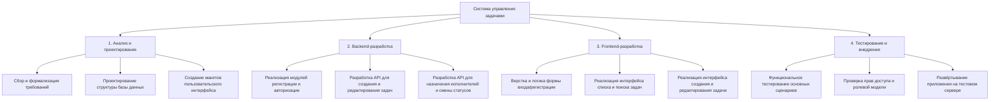

# Практическая работа №1

Исходная ситуация: Разработка системы управления задачами.

## Задание 1

## Задание 2

1. ТЗ и макеты утверждены (Завершение этапа анализа и проектирования)
2. Backend API полностью готов (Все эндпоинты разработаны и протестированы)
3. Интеграция завершена (Frontend успешно взаимодействует с Backend, основной функционал работает)
4. Продукт сдан в эксплуатацию (Приложение развёрнуто, критические баги исправлены)

## Задание 3

- Проектирование БД должно быть завершено до начала Разработки API
- Создание макетов интерфейса должно быть завершено до начала Frontend-разработки
- Функциональное тестирование не может начаться до завершения разработки Backend и Frontend
