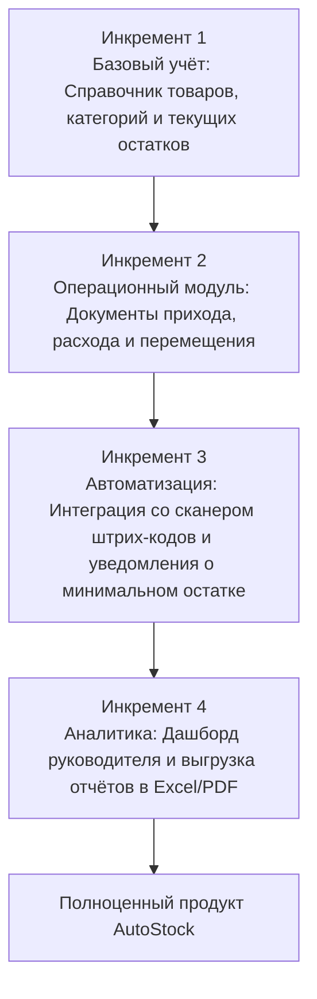

# Практическая работа №2

  # Обоснование выбора модели разработки программного проекта

1. Название проекта:
  AutoStock – система автоматизированного учёта товаров на складе малого бизнеса.

2. Краткое описание проекта:
  Веб-приложение для централизованного учёта поступления, перемещения и списания товаров, позволяющее сократить время на инвентаризацию и исключить ошибки ручного учёта за счёт автоматизации операций и системы уведомлений.

3. Анализ требований:
    - Понятность требований: Базовые требования понятны (учёт остатков, приход/расход), но детали интерфейса и специфические отчёты могут уточняться.
    - Возможность изменений: Заказчик (малый бизнес) с высокой вероятностью захочет изменить или добавить функции после просмотра работающего прототипа.
    - Разделимость на части: Да, систему можно чётко разделить на функциональные модули (справочники, операции, отчёты).
    - Промежуточные результаты: Регулярный показ важен для подтверждения правильности логики учёта.
    - Критичность сроков: Умеренная, но важен быстрый запуск базовой версии для начала реального использования.

4. Сравнение моделей:
   
| Модель| Как будет организована разработка?  | Преимущества для AutoStock  | Недостатки для AutoStock  |
|--|-----------|--------------------|---------------------|
|Итерационная |Делаем черновик всей системы, затем циклично улучшаем точность и удобство всех модулей сразу |Раннее выявление ошибок в логике учёта | Сложно показать заказчику "полуработу", требующую доработки всех частей одновременно|
|Инкрементальная|Поэтапное добавление работающих модулей:сначала справочник, потом операции, потом отчёты|Склад может начать пользоваться базовым учётом уже через месяц, не дожидаясь готовых отчётов|Требуется тщательное проектирование БД с самого начала |
|Waterfall|Сначала полное ТЗ, потом дизайн, потом код, потом сдача| Чёткий бюджет и сроки, понятная приёмка | Заказчик увидит систему только в конце, высок риск несоответствия реальным процессам склада |
|Agile|Короткие спринты с постоянной демонстрацией заказчику и гибким изменением бэклога |Максимальное соответствие реальным потребностям кладовщиков и менеджеров |При слабом контроле проект может бесконечно обрастать новыми "хотелками" заказчика |

5. Выбранная модель:
Инкрементальная модель (с элементами гибкого подхода внутри инкрементов).

7. Обоснование выбора:
 Для системы учёта склада критически важна надёжность базовой структуры данных. Инкрементальная модель позволяет сначала создать и утвердить фундамент (справочник товаров и базовые остатки), который сразу начнёт приносить пользу. Последующие инкременты (операции, сканеры, отчёты) надстраиваются поверх работающего ядра. Это снижает риски: даже если разработка затянется, у заказчика уже будет работающая базовая система учёта, а не сырой прототип. Жёсткая структура инкрементов дисциплинирует команду и не даёт проекту раздуться, как это бывает в чистом Agile.

8. Предварительный план разработки:

