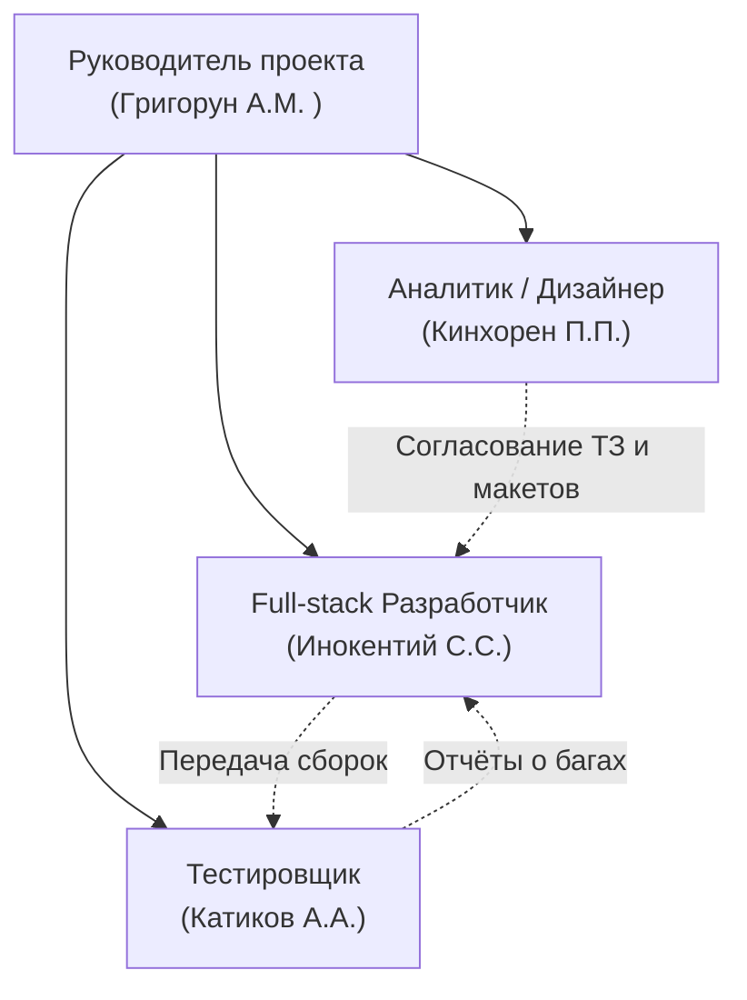

## Практическая работа №2

### 1. Необходимые роли и обязанности
Для проекта AutoStock сформирована компактная команда из 4 человек (с допустимым совмещением):

1. Руководитель проекта (PM)
   Обязанности: Контроль сроков, коммуникация с заказчиком, управление рисками
2. Системный аналитик / UI/UX-дизайнер (совмещение)  
   Обязанности: Сбор требований, проектирование структуры БД, создание макетов интерфейса склада
3. Full-stack разработчик 
   Обязанности: Написание кода Backend (API, логика склада) и Frontend (интерфейс), развёртывание на сервере
4. Тестировщик (QA)
   Обязанности: Составление тест-кейсов, функциональное тестирование, проверка соответствия ТЗ

### 2. Распределение участников и полномочия

| Роль | Участник | За какие результаты отвечает | Самостоятельные решения | Требует согласования с PM |
| --- | --- | --- | --- | --- |
| Руководитель (PM) | Гpигоpун А.М. | Сроки, бюджет, удовлетворённость заказчика | Перераспределение задач внутри команды | Изменение границ проекта (скоупа) или дедлайна |
| Аналитик / Дизайнер | Кинхоpен П.П. | Качество ТЗ, удобство интерфейса, структура БД | Выбор UI-компонентов, детализация полей в формах | Финальное утверждение ТЗ с заказчиком |
| Разработчик | Инокентий С.С. | Работоспособность кода, отсутствие багов, деплой | Выбор библиотек, фреймворков, структуры кода | Изменение архитектуры, влияющее на сроки |
| Тестировщик (QA) | Катиков А.А. | Качество продукта, полнота тестового покрытия | Отклонение сборки при наличии критических багов | Допуск продукта к финальному релизу (продакшн) |

### 3. Организационная структура команды

