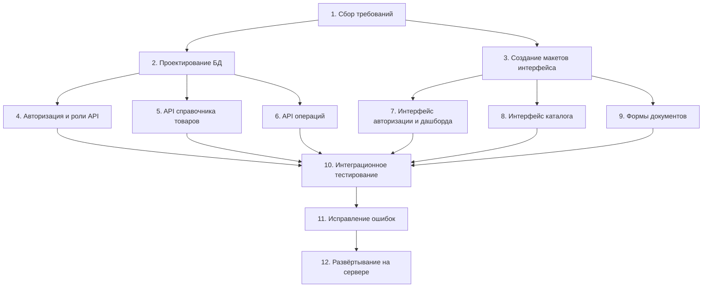
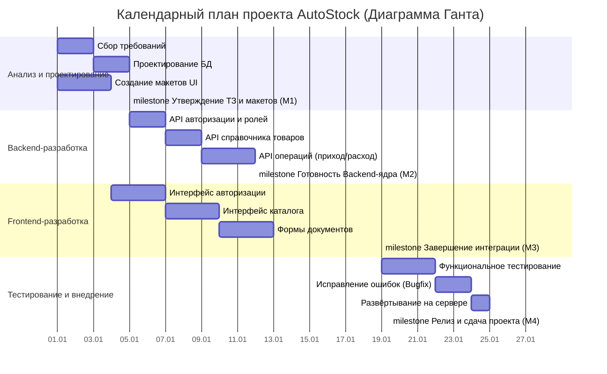

# Практическая работа №2

Название проекта: AutoStock – система автоматизированного учёта товаров на складе малого бизнеса.

## 1. Подготовка списка задач и оценка трудоёмкости

| № | Этап | Задача | Трудоёмкость (ч) | Ответственный |
| --- | --- | --- | --- | --- |
| 1 | Анализ и проектирование | Сбор и формализация бизнес-требований | 6 | Аналитик |
| 2 | Анализ и проектирование | Проектирование структуры базы данных  | 8 | Аналитик / Backend |
| 3 | Анализ и проектирование | Создание макетов интерфейса  | 8 | Аналитик |
| 4 | Backend-разработка | Реализация модуля авторизации и ролей | 10 | Backend-разработчик |
| 5 | Backend-разработка | Разработка API справочника товаров и категорий | 12 | Backend-разработчик |
| 6 | Backend-разработка | Разработка API операций (приход, расход, перемещение) | 16 | Backend-разработчик |
| 7 | Frontend-разработка | Верстка и логика страниц авторизации и дашборда | 12 | Frontend-разработчик |
| 8 | Frontend-разработка | Реализация интерфейса каталога и карточки товара | 14 | Frontend-разработчик |
| 9 | Frontend-разработка | Реализация форм оформления приходных/расходных документов | 16 | Frontend-разработчик |
| 10 | Тестирование и внедрение | Функциональное и интеграционное тестирование | 12 | Тестировщик  |
| 11 | Тестирование и внедрение | Исправление выявленных ошибок| 8 | Backend / Frontend |
| 12 | Тестирование и внедрение | Развёртывание приложения на продакшн-сервере | 4 | Backend-разработчик |

    Итого трудоёмкость: 126 человеко-часов.

## 2. Определение зависимостей между задачами

## 3. Диаграмма Ганта (Календарный план на 4 недели)

## 4. Контрольные точки 

| № | Название контрольной точки | Плановая дата | Ожидаемый результат |
| --- | --- | --- | --- |
| M1 | Утверждение проектной документации | 05.01 | Подписанное ТЗ, утвержденная схема БД и кликабельные макеты интерфейса |
| M2 | Готовность Backend-ядра | 12.01 | Все API-эндпоинты разработаны, задокументированы и успешно проходят тесты |
| M3 | Завершение интеграции | 19.01 | Frontend полностью подключен к Backend, все пользовательские сценарии работают в браузере |
| M4 | Релиз и сдача проекта | 28.01 | Приложение развёрнуто на рабочем сервере, критические ошибки устранены, подписан акт приёмки |
